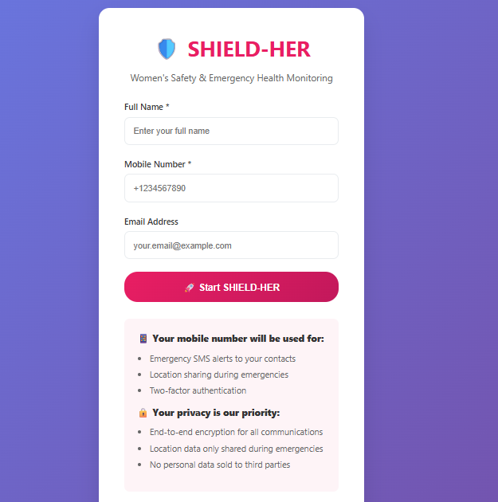
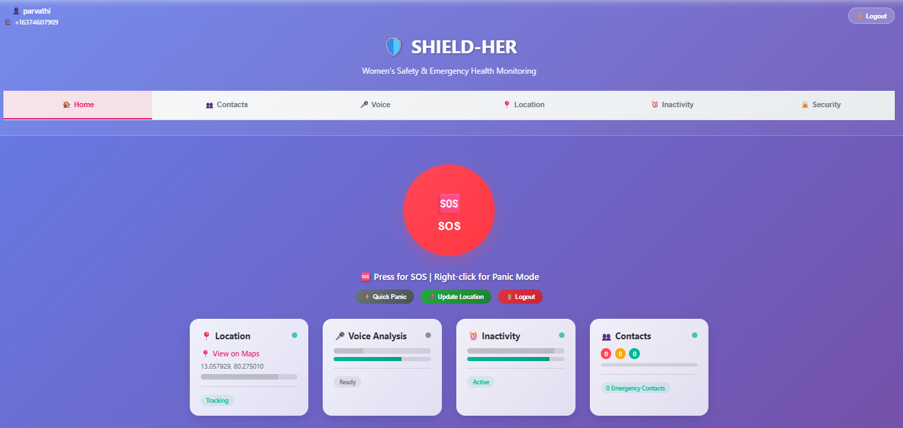
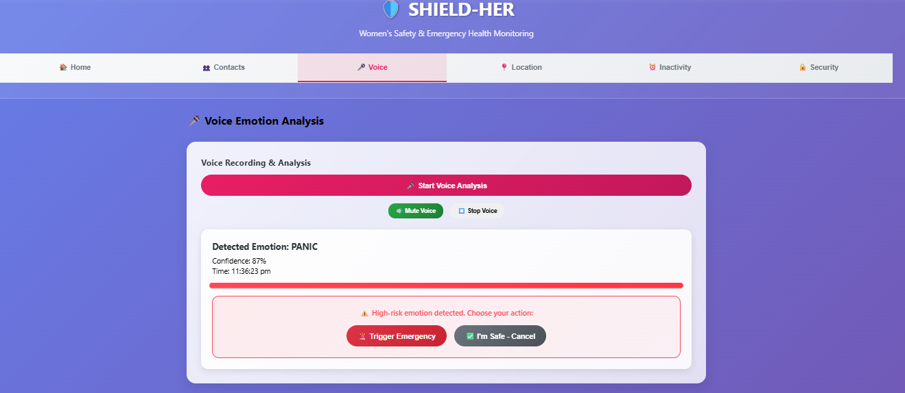

SHIELD-HER:

AI-Driven Women Safety and Health Alert System

SHIELD-HER is a women safety and health alert system designed to identify potential distress situations and support timely emergency responses in public spaces.

The project aims to combine intelligent distress detection, location monitoring and emergency alert mechanisms to improve personal safety.

Problem Statement

Women may encounter unsafe situations in public spaces where immediate assistance is difficult to access. SHIELD-HER aims to address this challenge through a technology-driven safety solution that can identify potential distress signals and notify registered emergency contacts.

Key Features

- Distress Detection: Message-based identification of potential distress situations.
- Location Monitoring: Uses geolocation to support location-aware safety alerts.
- Movement Monitoring: Designed to identify unusual movement patterns and inactivity.
- Emergency Alerts: Facilitates emergency notifications to registered contacts.
- Emergency Contact Management: Maintains registered emergency contact information.
- Safety Recommendations: Intended to provide relevant safety guidance.

Voice-based emotion analysis and additional intelligent monitoring capabilities are planned enhancements.

Technology Stack

Component| Technology

-Backend: Python, Flask
-Frontend: React, JavaScript, HTML, CSS
-Database: MySQL
-Communication: Twilio / EmailJS integration
-Location:Geolocation API
-Development:Visual Studio Code, XAMPP

Project

SHIELD-HER – AI-Driven Women Safety and Health Alert System

Developed by: Parvathi Murugadasan

GitHub: "Parvathi634" (https://github.com/Parvathi634)

## 📸 Application Screenshots

### Login Page

### Dashboard

### Emergency Alert

